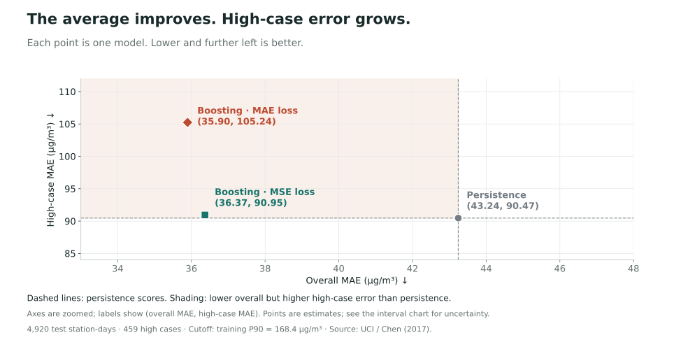
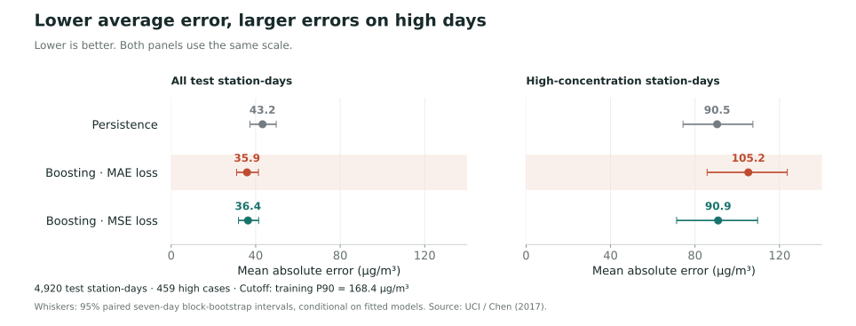
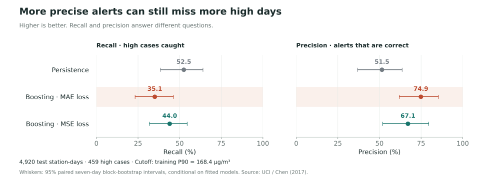

# PM2.5 forecasting: what average error misses

**Xiji Hang · Completed analysis · Python / pandas / scikit-learn / Matplotlib**

[Portfolio website](https://xijihang.github.io/data-science-portfolio/) · [Detailed methods](methods.md) · [Data attribution](DATA_SOURCES.md)

## Research question

Does choosing a next-day PM2.5 forecast by overall mean absolute error hide weaker performance on high-concentration station-days?

I adapted my completed CISC7204 Practice 07 project into this standalone repository. The benchmark compares persistence (tomorrow equals today) with two histogram gradient boosting models, trained with absolute-error and squared-error losses. It demonstrates time-aware preprocessing, forward evaluation and communication of a model trade-off.

## Findings

All three models are evaluated on the same **4,920 station-days** from January 2016 to February 2017. The high-concentration cutoff is **168.4 µg/m³**, the training target's 90th percentile. It defines **459** high-concentration test cases and is an analytical cutoff, not a regulatory standard.

| Model | Overall MAE (µg/m³) ↓ | High-case MAE (µg/m³) ↓ | Recall (%) ↑ | Precision (%) ↑ |
|---|---:|---:|---:|---:|
| Persistence | 43.24 | 90.47 | 52.51 | 51.50 |
| Boosting MAE | 35.90 | 105.24 | 35.08 | 74.88 |
| Boosting MSE | 36.37 | 90.95 | 44.01 | 67.11 |

MAE-trained boosting lowers overall error by **17.0%** compared with persistence, but its high-case error is larger and its recall is **17.4 percentage points lower**. Its alerts are more precise. These results support evaluating several task-relevant metrics together; they do not establish that boosting always underperforms persistence.



The joint view makes the trade-off visible: MAE boosting moves left of persistence (lower overall error) but upward (higher high-case error). Dashed lines mark the persistence scores, and the shaded region identifies this combination. Axes are zoomed to compare the estimates; uncertainty appears in the separate interval chart below.





## Data and permission

[Beijing Multi-Site Air Quality](https://doi.org/10.24432/C5RK5G), Chen, S. (2017), UCI Machine Learning Repository, is licensed under [CC BY 4.0](https://creativecommons.org/licenses/by/4.0/). The script downloads the public archive and verifies its SHA-256 before reading it. The raw archive is not committed. The station measurements contain no individual-level records. Full attribution, source links and transformations appear in [DATA_SOURCES.md](DATA_SOURCES.md).

## Method

1. Aggregate hourly observations on a complete station-calendar grid. Require at least 18 measured hours for current-day and target-day PM2.5; never impute targets.
2. Build completed-day pollutant/weather features, calendar lags and a trailing mean. Known target calendar variables are allowed; future measured weather is not.
3. Train on target dates through 31 December 2015. Test from origin dates starting 1 January 2016. Exclude the twelve boundary-crossing samples.
4. Fit both boosting models once with fixed parameters and seed `720407`. Evaluate all models on identical test rows.
5. Compute 95% percentile intervals using 2,000 paired circular seven-day block resamples, retaining all stations from each sampled date. Check alternative thresholds, block lengths and coverage requirements.

## Reproduce

Use **Python 3.12**. From the repository root:

```bash
python -m venv .venv
# Windows PowerShell:
.venv\Scripts\Activate.ps1
# macOS / Linux instead:
# source .venv/bin/activate
python -m pip install -r requirements.txt
python analysis.py
```

If PowerShell activation is disabled, use `.venv\Scripts\python.exe -m pip install -r requirements.txt` and `.venv\Scripts\python.exe analysis.py` directly. The first run needs Internet access to download approximately 8 MB from UCI. Subsequent runs use the checksum-verified local copy. Runtime depends on the machine and includes 4,000 bootstrap resamples across the main and sensitivity analyses.

The command regenerates `metrics.json`, local `test_predictions.json`, and the three SVG figures. To redraw only the figures from the committed numerical results, run `python plot_results.py`. Exact dependencies are pinned; small floating-point differences may occur across platforms.

## Limitations and next work

This is a historical benchmark from twelve Beijing stations, not a current forecasting service or a causal analysis. Station-days are equally weighted and are not independent city-wide pollution episodes. Missingness can affect representativeness. The bootstrap intervals are conditional on the fitted models; they omit training uncertainty. Threshold and time-period choices influence the comparison.

Next I plan to examine station-level errors, test rolling forecast origins and repeat the evaluation on more recent data before making deployment claims.

## Improvement following classmate feedback

Xiaoyu Guo reviewed the website and repository, correctly identifying the evaluation question, the average-versus-high-case trade-off and the historical scope. She suggested plotting overall MAE against high-case MAE so readers could compare both metrics at a glance. I added `mae-tradeoff.svg`, with labeled points for all three models, and made it the default portfolio view. The existing interval and alert charts remain available. This changes the presentation, not the fitted models or numerical results.

## Repository guide

- `analysis.py`: data download, checks, preprocessing, models, evaluation and figure generation.
- `plot_results.py`: three SVG visualizations from the calculated results, including the joint MAE comparison.
- `requirements.txt`: exact Python dependencies.
- `metrics.json`: full numerical results, uncertainty intervals and sensitivity checks.
- `methods.md`: detailed methods from the completed analysis.
- `AI_USAGE.md`: AI assistance disclosure.

The original coursework files are preserved separately. This public package contains the analysis and documentation, without forum submissions or course handouts.
